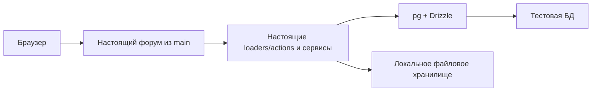

# Технический план Лёвы из чата: UI progress preview

Содержит самостоятельное техническое предложение Лёвы, ранее опубликованное в чате и перенесённое в #369 по прямой просьбе разработчика.

- Исследованная база: main `9cff976a9621d9fe5dfef28ea5367e390ff435b1`.
- Статус: предложение для обсуждения, не утверждённый implementation plan.
- Этот перенос не заменяет `research/concept.md`, не означает принятие концепции или назначение реализации и не меняет текущий этап #369.
- Текст сохраняет предложенное в чате направление, включая необходимость проверки PGlite и отдельного исполняющего preview runtime. Сопоставление с концепцией #369 этим переносом не выполнялось.

---

Нужен настоящий форум из актуального `main`, запущенный на тестовой инфраструктуре из репозитория. У preview должны остаться только запуск среды, тестовые данные и небольшая панель управления просмотром.

## 1. Что сейчас создаёт дублирование

Текущий [preview-app.tsx](https://github.com/iliya1947/vico-forum/blob/9cff976/app/ui-preview/preview-app.tsx) — около 2 200 строк. Он переиспользует настоящие компоненты, но самостоятельно:

- регистрирует маршруты через `createMemoryRouter`;
- собирает представления тем, сообщений, профилей и уведомлений;
- определяет доступность действий по выбранной preview-identity;
- блокирует отправку форм и часть authentication-действий;
- подключает отдельную сборку локализации.

Поэтому изменение настоящего loader, permissions или механики действия не обязательно попадает в preview. Общих компонентов для этого недостаточно.

При этом в [workers/app.ts](https://github.com/iliya1947/vico-forum/blob/9cff976/workers/app.ts) уже есть подходящая основа: приложение собирает зависимости и передаёт их настоящим маршрутам через request context.

## 2. Какую архитектуру я предлагаю

Preview становится отдельным способом запуска того же приложения:



Без второго router, второго набора экранов и preview-версий форумных команд.

Путь открытия темы, например, должен быть полностью настоящим:

`/:locale/topics/:topicId → настоящий loader → настоящий repository → тестовая БД → настоящий TopicView`.

Ответ, редактирование, закладка или административное действие проходят такой же настоящий путь через action, проверки и транзакцию.

**Подменять я предлагаю инфраструктуру ниже репозиториев.** Тогда нам не придётся заново реализовывать поиск, unread, permissions, уведомления, History и остальные правила.

## 3. Что делать с базой

Обычная JSON-база с самописными readers/writers здесь быстро станет новым параллельным backend. В текущем коде используются PostgreSQL-транзакции, блокировки, immutable revisions, триггеры, ограничения и системные каталоги. Их достоверная имитация не поместится в небольшой адаптер.

Самый близкий к твоей идее вариант — **встроенный PGlite с PostgreSQL socket-сервером**:

- тестовая база хранится в локальной папке;
- отдельный внешний PostgreSQL-сервис не требуется;
- приложение продолжает работать через нынешние `pg` и Drizzle;
- текущие repositories и SQL остаются общими с форумом.

У PGlite есть [официальный socket-сервер для PostgreSQL-клиентов](https://pglite.dev/docs/pglite-socket). Но его несколько подключений обслуживаются через один внутренний connection, и авторы прямо ограничивают гарантии совместимости.

Поэтому первый этап реализации — обязательная проверка пригодности:

- применить неизменённые migrations `main`;
- проверить Better Auth и его нативные hooks;
- выполнить настоящие чтения и записи форума;
- проверить несколько подключений, транзакции, rollback и используемые блокировки;
- открыть Admin и Owner Monitoring, включая запросы к PostgreSQL-каталогам;
- проверить работу под нынешними database deadlines.

**Если PGlite проходит этот набор — используем его. Если нет — берём изолированный PostgreSQL 17 в контейнере.** Не исправляем несовместимость переписыванием production SQL или обходами в доменной логике. Остальной план при такой замене не меняется.

Совместимость PGlite с этим проектом исполнением сейчас не проверялась; выдавать её за установленный факт было бы неправильно.

## 4. Как организовать файлы

Ориентировочная структура:

```text
preview/
  runtime.ts              запуск и остановка тестовой среды
  seed.ts                 загрузка исходного набора данных
  data/
    users.json
    forum.json
    personal-state.json
    moderation.json
    translations.json
    assets/
  scenarios.json          стартовые адреса и описания состояний

.preview-state/           созданная БД и файловое хранилище; вне Git
```

Названия пока условные.

Таким образом, **1–2 управляющих файла плюс папка данных — разумная цель**. Но весь implementation diff ими не ограничится: понадобятся изменения команд запуска, конфигурации preview, workflow и проверки.

В Git должны храниться читаемые исходные данные, а не постоянно изменяющиеся бинарные файлы БД. Рабочая база создаётся из migrations и seed. Её можно сбросить и воспроизвести.

Новой ручной копии схемы БД не будет: схема берётся из текущего `drizzle/`.

## 5. Какие данные нужны

Seed должен описывать связанные сущности, а не готовые props экранов.

| Группа | Необходимые состояния |
|---|---|
| Пользователи | обычные пользователи, moderator, admin, отдельный synthetic Owner, ограниченный и деактивированный аккаунты |
| Авторизация | настоящие назначения ролей, grants и overrides из действующего каталога |
| Форум | категории, разделы, темы, сообщения, revisions, ответы на сообщения, теги |
| Состояния тем | обычная, закрытая, закреплённая, решённая, лучший ответ, duplicate и Help signals |
| Личное | Watch, Bookmarks, Mute/Block, read-state, уведомления |
| Административное | меры, appeals, Complaints, решения, History |
| Локализация | активные locales, оригиналы и сохранённые revision-bound переводы |
| Файлы | реальные тестовые изображения и вложения с согласованными DB references |

Не нужно хранить отдельно «число сообщений для карточки» или «права для кнопки». Они вычисляются настоящим кодом из тестовой БД.

В seed нужны устойчивые идентификаторы, чтобы ссылки были воспроизводимыми. Временные состояния — сроки мер, unread и недавняя активность — формируются относительно времени создания sandbox, чтобы набор не переставал работать через месяц.

Загрузка должна учитывать FK, immutable revisions и связанные состояния. Где удобно, использовать настоящие domain-команды; где нужен подготовленный исторический набор — корректные fixture inserts с последующей проверкой целостности.

## 6. Какие части инфраструктуры заменяются

| Зависимость | Решение для preview |
|---|---|
| PostgreSQL/Hyperdrive | локальная тестовая БД; существующие bindings направляются на неё |
| R2 | локальное хранилище через текущий Cloudflare/Miniflare tooling |
| Better Auth | настоящий Better Auth с тестовыми аккаунтами и настоящими cookies |
| Google OAuth | внешний вход недоступен; для preview используются тестовые email/password аккаунты |
| Переводы | настоящий registry, manual packs и сохранённые тестовые content translations |
| Внешние providers/Queues | не вызываются; используются фактические возможности `main` и подготовленные состояния данных |

[Локальные подключения Hyperdrive](https://developers.cloudflare.com/hyperdrive/configuration/local-development/) и [локальное R2](https://developers.cloudflare.com/r2/api/workers/workers-api-usage/) уже поддерживаются инструментами. В проекте есть Worker/Better Auth/PostgreSQL browser acceptance и локальное R2 — этот опыт можно переиспользовать.

Тестовый Owner задаётся через отдельный synthetic `VICO_OWNER_USER_ID`. Переключатель роли не должен просто сообщать компонентам `isAdmin=true`.

Действия, отсутствующие в `main`, preview не изображает работающими. Например, отключённая в настоящем runtime генерация переводов не получает самостоятельную preview-реализацию.

## 7. Что останется от панели preview

Небольшой controller вне интерфейса форума:

- выбор тестового аккаунта;
- стартового сценария;
- размера viewport;
- сброс sandbox;
- отображение используемого SHA.

Сценарий — это ссылка на реальные данные, например «открыть эту закрытую тему под этим пользователем». Он не создаёт другую страницу темы.

Выбор пользователя выполняет настоящий вход тестового аккаунта. После переключения форум заново загружается с настоящей session и server-side permissions.

Тема, язык, навигация и остальные пользовательские настройки работают через интерфейс самого форума. Отдельный `preview-i18n.ts` больше не нужен.

Сброс должен согласованно восстанавливать БД и файлы, завершать прежние сессии и возвращать исходное состояние. Управляющие операции существуют только в preview runtime и не попадают в production Worker.

## 8. Важное ограничение размещения

Сохранить настоящий форум с SSR, серверными actions и authentication **только статическими файлами GitHub Pages нельзя**. Нынешняя [Pages-сборка](https://github.com/iliya1947/vico-forum/blob/9cff976/.github/workflows/ui-preview-pages.yml) именно статическая.

Для нового preview нужен исполняющий процесс.

Я предлагаю один изолированный preview-контейнер: Node, локальный Worker runtime, встроенная тестовая БД и локальные файлы. Он собирается из репозитория и открывается по браузерной ссылке. Отдельные production БД, R2, OAuth и translation credentials ему не нужны.

Controller и форум следует разместить на одном origin. Это сохранит обычные cookies, forms и redirects и позволит избежать проблем с authentication внутри iframe на другом сайте.

GitHub Pages можно оставить переходной ссылкой на новый preview. Полностью браузерный перенос серверного приложения был бы отдельным, значительно более крупным проектом; для этой задачи я его не выбираю.

Конкретный хост такого контейнера пока не определён. Это оставшийся вопрос размещения, а не причина создавать вторую реализацию форума.

## 9. Как preview будет автоматически следовать за main

При обновлении `main` pipeline:

1. Берёт конкретный новый SHA.
2. Собирает обычное приложение.
3. Создаёт чистую тестовую БД из migrations этого SHA.
4. Загружает seed и тестовые файлы.
5. Проверяет запуск и основные сценарии.
6. Только после успеха переключает ссылку preview на новую сборку.

Нельзя незаметно показывать старую сборку под подписью нового `main`. При ошибке подготовки сохраняется предыдущий рабочий preview с его фактическим SHA.

Основной адрес обновляется только из `main`. При необходимости отдельные feature-preview получают собственные адреса и не перезаписывают его.

Новые маршруты появляются автоматически из настоящего `app/routes.ts`. Новая предметная сущность иногда потребует новых fixture-данных, но не повторной реализации экрана или поведения.

## 10. Последовательность реализации и критерии готовности

| Этап | Работа | Условие завершения |
|---|---|---|
| 1 | Проверить PGlite на существующем backend; при несовместимости выбрать PostgreSQL 17 | Движок выбран на основании выполнения критических путей |
| 2 | Поднять настоящий Worker с тестовыми bindings и минимальным seed | Работают реальные public routes, SSR, вход и одна запись |
| 3 | Добавить связанный набор данных для всех нынешних областей форума | Основные состояния доступны через настоящие маршруты и permissions |
| 4 | Подключить controller, переключение аккаунтов и reset | Нет поддельных permissions, blocked forms и параллельного router |
| 5 | Настроить сборку из `main` и размещение по ссылке | Успешное обновление SHA автоматически обновляет preview |
| 6 | Переключить просмотр и удалить старую реализацию | `preview-app.tsx` больше не поддерживает отдельную механику форума |

До удаления старого preview проверяется полный связанный проход: вход → создание темы → ответ → редактирование → Watch/Bookmarks/Mute/Block → уведомления → соответствующие Admin/Complaints действия. Отдельно — права гостя, пользователя, moderator/admin и Owner, RU/EN/HE и RTL, мобильный viewport, вложения, прямое открытие URL и перезагрузка.

Ключевой критерий отсутствия дублирования: **изменение маршрута, компонента или доменной команды в `main` должно менять preview без правки preview-реализации этой функции**.

Это направление я считаю правильным: небольшой воспроизводимый стенд вокруг настоящего приложения. Основная сложность будет в качественном наборе связанных данных и запуске среды; повторять сам форум больше не потребуется.
